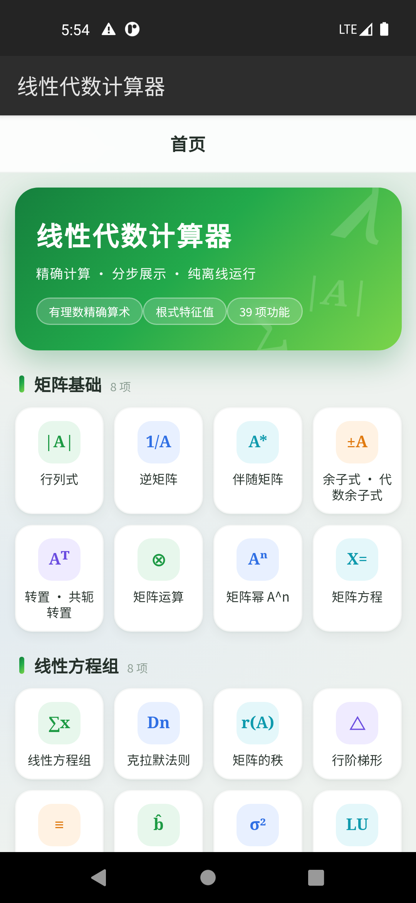
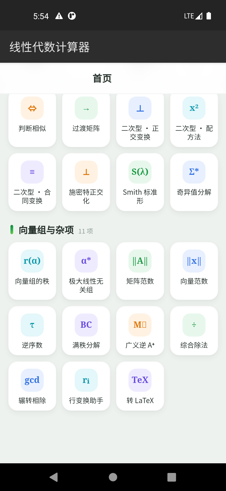

# 线性代数计算器（LA Calc）

纯离线的线性代数计算器：**精确有理数算术 + 分步解题展示 + KaTeX 渲染**，不依赖任何服务器。

| Android | 桌面 | Web |
|---|---|---|
| [下载 APK](../../releases/latest) | [下载 Release](../../releases/latest)（Win/Linux/macOS） | [下载 Web zip](../../releases/latest) 或直接用浏览器打开 `dist/web/index.html` |

iOS：Safari 打开 Web 在线版 → 分享 →「添加到主屏幕」，即得全屏离线 PWA。

<p align="center">
  
  
</p>

## 功能（39 项）

- **矩阵基础**：行列式（消元步骤）、逆矩阵 ((A|E) 初等行变换)、伴随、余子式/代数余子式、转置/共轭转置、矩阵运算、矩阵幂、矩阵方程 AX=C / XA=C / AXB=C
- **线性方程组**：唯一解 / 含自由变量通解 / 无解判定、克拉默法则、矩阵的秩（**含单参数情形分析**，如 a=−1 时讨论）、行阶梯形、行最简形、最小二乘、最优最小二乘（A⁺b）、LU 分解
- **特征值族**：特征值与特征向量（**精确根式**，如 λ=3±√15）、相似对角化、Jordan 标准形（有理特征值）、相似性判断（Jordan 结构比较）、过渡矩阵、二次型三变换（正交 / 配方 / 合同）、施密特正交化、Smith 标准形（λ-矩阵）、SVD（数值）
- **向量组与杂项**：向量组的秩、极大线性无关组、矩阵/向量范数（1/2/∞/F）、逆序数、满秩分解、广义逆 A⁺、综合除法、辗转相除、行变换助手、转 LaTeX

输入语法与主流线代计算器一致：换行分行、空格分列，支持 `3/2` 分数、`0.2` 小数、`a**2` 幂、`sqrt(2)`/`√2` 根式、`pi`、复数 `1+2I`、单字母符号 `a b x λ`。

## 特点

- **精确**：不是浮点模拟——内置 BigInt 有理数、多变量多项式、二次根式域 ℚ(√D)，`det`、`inv`、`特征值` 给出的是精确分数与根式
- **分步**：行列式/逆/秩/方程组等输出每一步初等行变换（`r₂+4r₁` 标注），与教材书写一致
- **离线**：Android 端不声明 INTERNET 权限，构造上无网络；桌面/Web 全部本地计算
- **渲染**：KaTeX 本地渲染，无图片下载

## 架构

```
src/la-engine/   计算引擎（零依赖 JS）：frac/algebra(Poly,UPoly,QD,CCplx)/expr 解析
                 /matrix(Gauss,Bareiss 思路消元)/linear(方程组族)/eigen(特征族)
src/tests/       引擎测试（74+ 断言）与 KaTeX 渲染冒烟
la-app/          Android 壳（WebView，2 个 Java 类）+ 构建脚本 aapt2→javac→d8→apksigner
electron/        桌面壳（加载同一套 web 资产）
scripts/         Web 版打包
.github/workflows/release.yml   推送 v* tag 后三系统 CI 自动构建并发布 Release
```

引擎不依赖任何数学库，全部算法从零实现（牛顿恒等式求特征多项式、有理根试除 + 二次因子精确求根、分数域高斯消元、Faddeev 式 Jordan 块判定等）。

## 本地构建

```bash
npm i
npm run test:engine        # 引擎测试
npm run build:web          # Web 版 → dist/web + zip

# Android（需 JDK 17+ 与 Android SDK: platforms;android-30, build-tools;34.0.0）
ANDROID_SDK=$ANDROID_HOME JAVA_HOME=$JAVA_HOME node la-app/build-apk.js
#   → la-app/out/la-calc.apk

# 桌面（Electron）
node scripts/build-web.js && node -e "fs.cpSync('dist/web','electron/web',{recursive:true})"
cd electron && npm i && npx electron-builder --win --linux --mac
```

## 限制（如实声明）

- 特征多项式含**不可约三次及以上**因子或复特征值时不给近似冒充精确解，明确提示不支持
- SVD 为 6 位有效数字的数值结果；对称阵嵌套根式范数情形不支持
- 符号矩阵的行最简形（RREF）未支持，秩/行列式支持参数讨论

## 许可

MIT © 2026。内置 [KaTeX](https://katex.org/)（MIT）。
